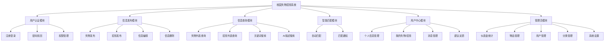
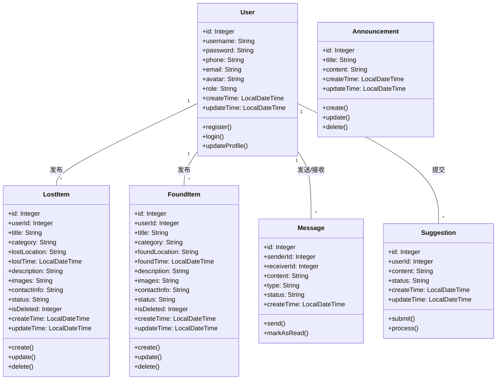
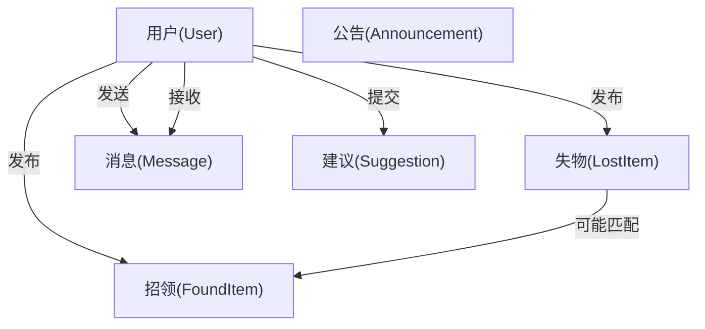
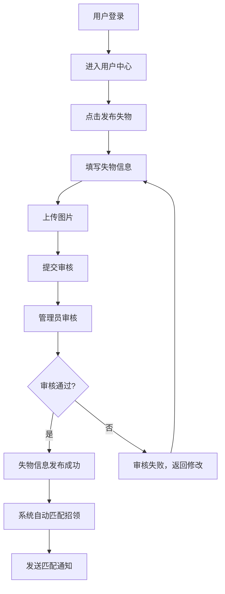

# 校园失物招领系统 UML图表

## 功能模块图



## 普通用户用例图

```mermaid
useCaseDiagram
    actor User as "普通用户"
    
    usecase UC1 as "注册登录"
    usecase UC2 as "发布失物"
    usecase UC3 as "发布招领"
    usecase UC4 as "查询失物"
    usecase UC5 as "查询招领"
    usecase UC6 as "AI描述搜索"
    usecase UC7 as "管理个人信息"
    usecase UC8 as "查看我的发布"
    usecase UC9 as "接收消息通知"
    usecase UC10 as "提交建议"
    
    User --> UC1
    User --> UC2
    User --> UC3
    User --> UC4
    User --> UC5
    User --> UC6
    User --> UC7
    User --> UC8
    User --> UC9
    User --> UC10
```

## 管理员用例图

```mermaid
useCaseDiagram
    actor Admin as "管理员"
    
    usecase UC1 as "登录系统"
    usecase UC2 as "审核物品信息"
    usecase UC3 as "管理用户"
    usecase UC4 as "管理物品分类"
    usecase UC5 as "查看系统统计"
    usecase UC6 as "系统设置"
    usecase UC7 as "处理用户建议"
    
    Admin --> UC1
    Admin --> UC2
    Admin --> UC3
    Admin --> UC4
    Admin --> UC5
    Admin --> UC6
    Admin --> UC7
```

## 类图



## E-R图



## 招领部分流程图


## 失物部分流程图

